<div align="center">



<a href="https://git.io/typing-svg"></a>

<p>
  <a href="https://www.linkedin.com/in/balachandra-raju-1435b828a/"></a>
  <a href="mailto:rajmesar03@gmail.com"></a>
  <a href="https://rajmesar.github.io/portfolio/"></a>
  
</p>

</div>


## 🍷 About Me

```yaml
name:      Balachandra Raju M
role:      Senior Data Engineer @ The Hartford Insurance Group
previous:  [Cognizant — Data Analytics Engineer, Empower Financial Services — Power BI Developer, ANZ Bank — BI Analyst]
education: M.S. Business Analytics, University of New Haven (GPA 3.92, Dec 2024)
domains:   [Insurance, Banking, Finance]
focus:     Cloud data migration · scalable pipelines · BI · predictive analytics
learning:  [Advanced Snowflake & Databricks, Time-Series Forecasting in R, Data Governance & Privacy]
```

## 🏆 Impact Highlights

<table>
<tr>
<td align="center" width="25%"><h2>40%</h2><sub>Lower query latency after leading the Oracle → Snowflake migration</sub></td>
<td align="center" width="25%"><h2>100+</h2><sub>ADL pipelines & data models over 1.5TB+, reporting 30% faster</sub></td>
<td align="center" width="25%"><h2>$7.45M</h2><sub>Credit write-off reduction from Power BI dashboards & regression models</sub></td>
<td align="center" width="25%"><h2>85%+</h2><sub>Accuracy on inflation-adjusted S&P 500 forecasts</sub></td>
</tr>
</table>

- ⚙️ Automated SSIS ETL workflows and secured Snowflake integrations — **40%** more efficient reporting
- 🛒 Built Apriori-based product-targeting models for market-basket insights
- 🌾 Delivered policy dashboards to ANZ stakeholders for government use — **20%** better food-security planning

## 🧰 Tech Stack

<p align="left">
  <b>Cloud & Data Platforms</b><br/>
  
  
  
  
  
  <br/><br/>
  <b>Languages & Analytics</b><br/>
  
  
  
  <br/><br/>
  <b>BI & Visualization</b><br/>
  
  <br/><br/>
  <b>Practices</b><br/>
  
  
  
</p>

## 📂 Featured Projects

<table>
<tr>
<td width="50%" valign="top">

### 📊 [PowerBI-Projects](https://github.com/rajmesar/PowerBI-Projects)
Interactive Power BI dashboards focused on business KPIs and visual storytelling.

`Power BI` `DAX` `Data Modeling`

</td>
<td width="50%" valign="top">

### 📈 [forecasting-report](https://github.com/rajmesar/forecasting-report)
Time-series forecasting report with model comparison and accuracy analysis.

`Forecasting` `Statistics` `Reporting`

</td>
</tr>
<tr>
<td width="50%" valign="top">

### 🎨 [Data-Visualization](https://github.com/rajmesar/Data-Visualization)
Master's project exploring analytical visualization and data storytelling.

`Visualization` `Python` `Analytics`

</td>
<td width="50%" valign="top">

### 💼 [Portfolio](https://rajmesar.github.io/portfolio/)
Business-analyst portfolio showcasing case studies, dashboards and experience.

`HTML` `GitHub Pages`

</td>
</tr>
</table>

## 📊 GitHub Analytics

<div align="center">
  
  
  <br/>
  
  <br/>
  
</div>

## 🐍 Contribution Heatmap

<div align="center">
  
</div>

## ☕ Beyond Data

I enjoy designing creative dashboards, visual storytelling and digging into economic trends. Off the clock you'll find me reading finance blogs, trying new cuisines, or sharing tech knowledge with peers. 📚🍜💬

<div align="center">

**Open to collaborating on data engineering, automation and analytics — let's connect!**


</div>
